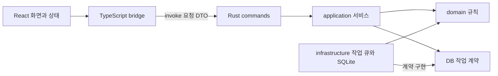

# 코드 구성과 의존성

상태: React 자료 선택·시험·결과·자동 저장과 재개·기록 화면, Rust 초기 등록·시험 저장·채점·진행 저장·기록 조회와 3가지 출제 모드 구현. 자료 교환과 백업·복구는 후속 단계다.

```text
Window/
  package.json, package-lock.json, .node-version
  index.html, vite.config.ts, tsconfig.json
  src/
    main.tsx, App.tsx, styles.css   현재 화면 진입점과 시제품
    bridge/desktop.ts              유일한 invoke 호출 경계
    features/exam/                문제 풀이·제출·결과·기록 목록·저장 hook·조정과 고정 공백
  src-tauri/
    Cargo.toml, tauri.conf.json, capabilities/
    src/
      main.rs, lib.rs              실행점, 경로와 상태·자료 목록 명령
      error.rs                    구조화 오류
      validation.rs, package.rs   고정 공백·ID와 JSON 검증
      storage.rs, worker.rs       SQLite 등록·조회와 전용 스레드
      storage/tests.rs            저장·재실행·거부·롤백 검증
      exam.rs                     시험 DTO·요청 검증·정확 채점·모드별 선택과 표시 순서
      storage/exams.rs            시험 생성·제출·완료·결과 조회
      storage/exams/tests.rs      시험 처리와 실제 채점 예시 검증
      storage/history.rs          후보 수·프로필별 기록 필터와 정렬
      storage/history/tests.rs    오답 출제·범위·기록·집계·과거 결과 보존 검증
      commands/                   향후 명령 증가 시 lib.rs에서 분리
      application/                사용 사례와 DB 작업 계약·DTO
      domain/                     자료·시험 모델과 순수 출제·채점·집계
      infrastructure/             JSON·SQLite·파일·백업·DB 작업 큐
    migrations/                   초기 스키마와 이후 구조 변경
    resources/initial-data/       실제 자료의 로컬 사본, Git 제외
  dist/                           웹 번들, Git 제외
  src-tauri/target/                Rust 산출물, Git 제외
```

## 호출 방향



React는 화면·폼·요청 상태를 담당한다. application은 출제·저장·제출 등 사용 사례를 조정하고 domain은 I/O 없는 규칙을 계산한다. infrastructure는 DB 작업과 파일 수명을 관리한다. 명령에서 SQL을 직접 조합하거나 React로 원본 정답 전체를 전달하지 않는다.

| 기존 책임 이름 | 새 구조의 배치 |
| --- | --- |
| AppBootstrapper | Rust 초기화 조정과 Tauri setup |
| InitialDataService·DatasetService | application의 자료 등록·조회 서비스 |
| ExamService·ExamQueryService | application의 시험 변경·조회 서비스 |
| QuestionSelector·ExactGrader·ProgressReducer | domain의 순수 함수와 모델 |
| DbWorkQueue·Repositories | infrastructure의 단일 DB 작업 스레드와 세션 |
| TransferService·BackupManager | application 조정과 infrastructure의 파일·백업 구현 |
| 화면 입력과 저장 타이머 | React 기능별 hook·reducer와 autosave coordinator |

서비스 이름은 책임을 설명한다. Rust의 함수명은 snake_case를 사용한다. 각 명령의 이름과 반환 경계는 [화면 연결](09_화면연결과오류처리.md), DB 경계는 [저장소 접근](04_저장소접근과트랜잭션.md)을 따른다.
