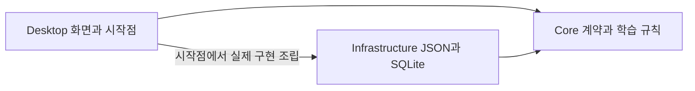

# 코드 구성과 의존성

상태: 생성할 코드의 위치와 책임을 정한 구현 기준. 현재 아래 프로젝트는 생성 전이다.

```text
Window/
  StudyApp.sln
  src/
    StudyApp.Desktop/          WPF 시작점·화면·ViewModel
      Bootstrap/              AppBootstrapper, AppPaths, SingleInstanceGuard
      Views/                  Setup, Exam, Submit, Results, History, Transfer
      ViewModels/             각 화면의 입력·표시 상태와 명령
      Presentation/           NavigationService, DialogService, AutosaveCoordinator
    StudyApp.Core/             화면과 SQLite에 의존하지 않는 학습 처리
      Models/                 학습 자료·시험·응답·학습 상태 모델
      Contracts/              저장소 세션·자료 읽기·서비스 요청과 반환 DTO
      Services/               InitialDataService, DatasetService, ExamService,
                              ExamQueryService, TransferService
      Rules/                  QuestionSelector, ExactGrader, ProgressReducer
    StudyApp.Infrastructure/   JSON·SQLite·파일 접근의 실제 구현
      Json/                   LearningPackageReader, PackageValidator, PackageWriter
      Sqlite/                 DbWorkQueue, ConnectionFactory, DatabaseInitializer,
                              SqliteReadSession, SqliteWriteSession, Repositories/
      Migrations/             V001_Initial.sql과 이후 명시적 버전 변경
      Files/                  BackupManager
  tests/
    StudyApp.Core.Tests/       출제·채점·오답 집계 검증
    StudyApp.Infrastructure.Tests/ 실제 임시 SQLite와 JSON·파일 통합 검증
```

루트의 `data/initial`은 Git에서 제외한 로컬 자료이고, 배포 파일은 [초기 자료 연결](03_초기자료연결.md)의 빌드 규칙으로 복사한다. Windows 문서는 Window 아래에 두고 공통 명세는 루트의 공통 개발 문서에서 참조한다.

## 참조 방향



Core는 WPF·SQL·파일 시스템 API와 연결 객체를 참조하지 않는다. ViewModel은 Core의 서비스를 호출하고 SQL이나 자료 파일을 직접 읽지 않는다. Desktop이 Infrastructure를 참조하는 용도는 시작점에서 저장소와 서비스 객체를 생성·연결하는 것이다.

## 주요 책임

| 담당 | 책임 |
| --- | --- |
| `AppBootstrapper` | 경로·단일 실행·초기화 후 서비스와 첫 화면 생성 |
| `InitialDataService` | 검증된 초기 패키지를 한 번만 등록 |
| `DatasetService` | 현재 로컬 프로필 기준 자료와 모드별 출제 가능 수 조회 |
| `ExamService` | 시험 생성, 진행 저장, 제출과 완료 처리 |
| `ExamQueryService` | 이어 풀기·기록·결과의 읽기 전용 DTO 생성 |
| `QuestionSelector`, `ExactGrader`, `ProgressReducer` | 입력 모델에서 결과를 계산하는 순수 규칙 |
| `DbWorkQueue`와 세션 | DB 작업 직렬화, 연결과 트랜잭션 수명 관리 |
| `TransferService` | 가져오기 검증·미리보기·갱신과 내보내기 조정 |
| `BackupManager` | DB 백업·검증·복구와 구조 변경 전 보존 |

ViewModel별 서비스 연결은 [화면 연결](09_화면연결과오류처리.md), 서비스와 DB의 계약은 [저장소 접근](04_저장소접근과트랜잭션.md)에 둔다.
