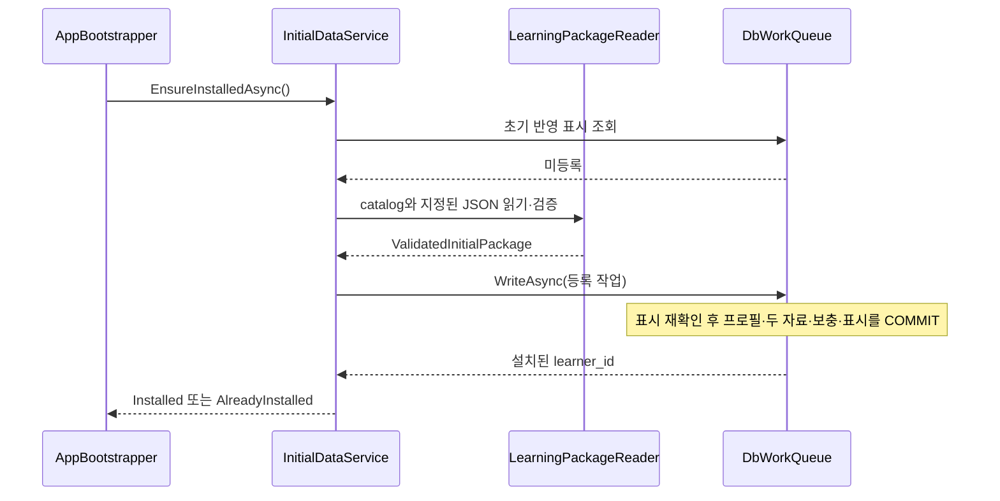

# 초기 JSON 자료와 저장소 연결

상태: 초기 구현 기준. 실제 자료는 Git에 없는 로컬 data에 보관하고 배포용 사본도 Git에서 제외한다.

## 빌드 시 자료 배치

Window/src/StudyApp.Desktop 프로젝트의 Content 항목으로 루트 `data/initial`의 다음 파일만 선택해 출력과 publish 폴더의 `Assets/InitialData` 아래에 같은 상대 경로로 복사한다.

```text
Assets/InitialData/
  catalog.json
  android/learning.json
  android/supplement.json
  basic-cs/learning.json
  basic-cs/supplement.json
```

기준 목록은 [catalog.json](../../data/initial/catalog.json)이다. Android `107`, 일반 CS `147`, 합계 `254`문항을 등록한다. 원문·문제집·검증 예시·변환 보고서와 기존 22문항 파일럿은 실행 패키지에 넣지 않는다. 채점 예시 파일은 테스트 프로젝트에서 별도로 참조한다.

## 자료를 DB로 옮기는 담당



`LearningPackageReader`는 catalog의 상대 경로를 패키지 루트 안에서만 해석한다. 상위 경로 이탈과 중복 묶음 ID는 거부한다. catalog의 개수와 실제 배열 길이가 다르면 오류로 보고 일부 자료만 등록하지 않는다.

패키지 루트는 AppBootstrapper가 reader 생성자에 주입한다. reader 계약은 `ReadInitialAsync()` → `ValidatedInitialPackage`이며 Core가 직접 디스크 경로를 조립하지 않는다. JSON의 snake_case 필드는 DTO의 `JsonPropertyName`으로 명시해 연결하고, 필드 이름의 대소문자를 임의로 허용하지 않는다.

`PackageValidator`는 JSON 1.0과 필수 문자열·배열 형식, ID 유일성, 질문·짧은 정답과 허용 표기, 보충 항목의 같은 묶음·문항 연결을 확인한다. 임의 trim·대소문자 변경·정답 추출을 하지 않는다. 작성 과정의 의미 검토 기준은 [문항 작성](<../../공통 개발 문서/상세설계/데이터/04_단답형문항작성.md>)을 따르며, 런타임 검증이 개념의 정확성을 보증하지는 않는다. 보충 파일은 선택적이고 원문 파일의 존재는 요구하지 않는다.

## 필드 매핑

| JSON 입력 | DB 저장 | 이후 사용하는 곳 |
| --- | --- | --- |
| `dataset_id`, `title` | `datasets` | 자료 목록·범위와 시험 자료명 스냅샷 |
| catalog 순서와 `items` 배열 순서 | 자료·문항의 `position` | 기본 목록과 순서대로 출제 |
| `id`, `question`, `answer` | `items` | 새 시험의 문항 스냅샷 생성 |
| `accepted_answers` | `accepted_answers_json` | 등록 표기 채점. 생략은 빈 배열 |
| 보충 `items`의 선택 정보 | `supplements.payload_json` | 완료 결과 화면의 현재 해설 |
| 보충 `dataset_metadata` | `datasets.metadata_json` | 자료 교환 시 메타데이터 보존 |

첫 등록에서 `learner_id`를 새로 만들고 `app_metadata.local_learner_id`와 `initial_data_installed=1`을 함께 저장한다. 같은 트랜잭션 안에서 다시 등록 여부를 확인하므로 재시도로 자료나 프로필이 늘지 않는다. 이미 등록되어 있으면 JSON을 덮어쓰지 않고 보존된 ID를 반환한다. 등록 표시만 없는데 프로필·자료·시험이 이미 있는 경우는 불일치 오류로 처리하며 새 초기 자료로 덮어쓰지 않는다.

자료 변경은 `TransferService`를 통한 명시적 갱신만 사용한다. 테이블과 저장 형식은 [DB 스키마](04_1_DB스키마.md), 이후 화면 조회는 [시험 생성과 조회](05_시험생성과조회.md)를 따른다.

새 clone에는 실제 data가 없다. 로컬 자료를 별도로 준비하지 않으면 자료 포함 publish와 초기 등록에 필요한 파일이 없음을 명시적으로 안내한다. 빈 자료를 정상 초기화로 처리하거나 원격에서 자동 내려받지 않는다. [데이터와 Git 관리](<../../공통 개발 문서/개발원칙/01_실제데이터와Git관리.md>)를 따른다.
