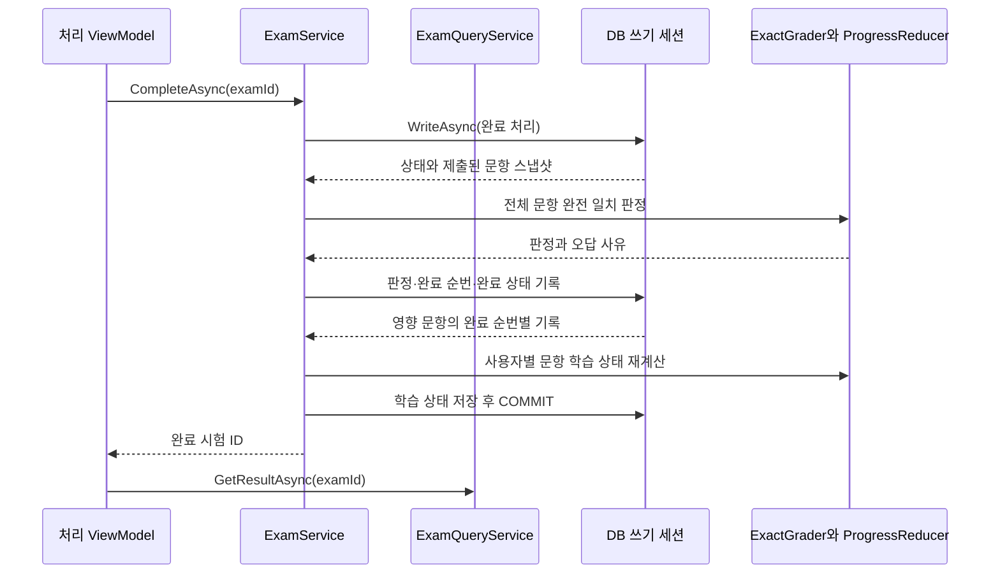

# 제출과 채점 및 결과 처리 연결

상태: 구현 기준. 최종 제출과 완료는 각각 별도의 원자적 쓰기 작업으로 실행한다.

## 최종 제출

`SubmissionViewModel`은 입력 배열에서 빈 문자열 또는 `IsNullOrWhiteSpace`인 문항 번호를 계산해 안내한다. 그대로 제출을 선택하면 `ExamService.SubmitAsync(ProgressSnapshot)`를 호출한다. 미응답 검사에서도 저장할 원문을 변경하지 않는다.

쓰기 트랜잭션에서 로컬 프로필과 시험 상태를 확인하고, in_progress일 때 [진행 저장](06_응답저장과재개.md)의 revision 검사를 적용한 최신 답변과 위치를 `submitted`, submitted_at과 함께 확정한다. 낮은 버전이나 충돌이면 제출하지 않는다. 이미 submitted/completed인 동일 시험이면 기존 상태를 반환하고 답변을 덮어쓰지 않는다.

요청 중에는 중복 입력을 막고, 성공 후 답변을 확정 잠금한다. 롤백이 확인된 실패면 작성 화면으로 복귀할 수 있다. COMMIT 여부가 불분명하면 작성 가능으로 즉시 되돌리지 않고 같은 ID의 상태를 재조회한다. submitted면 처리 재개, completed면 결과 조회, in_progress면 보존한 입력으로 재시도한다. 조회도 실패하면 입력을 유지한 오류 상태로 남긴다.

## 완료 처리의 호출 순서

`CompleteAsync`는 이미 completed면 변경 없이 반환하고 in_progress면 거부한다. submitted일 때만 저장된 `exact-v1` 규칙을 선택해 계산한다. 알 수 없는 규칙 버전은 오류로 남기고 현재 규칙으로 임의 채점하지 않는다.

`ExactGrader`는 빈 답과 공백뿐인 답을 `incorrect/unanswered`로 처리한다. 나머지는 대표 정답과 등록 허용 표기를 `StringComparison.Ordinal`로 비교해 correct 또는 incorrect/no_match를 반환한다. trim·대소문자 변환·Unicode 정규화는 하지 않는다.

같은 트랜잭션 안에서 `MAX(completion_order)+1`을 사용자별로 부여하고 전체 판정과 completed_at·saved_at·completed 상태를 기록한다. 현재 시험을 포함한 완료 기록을 완료 순번대로 읽어 `ProgressReducer`로 영향 문항의 상태를 재계산한다. 사용자·완료 순번의 유일 제약도 검사한다. 중간 실패는 판정과 상태 및 순번을 모두 롤백한다.

## 학습 상태와 결과 조회

`ProgressReducer`는 문항마다 오답이면 대상 편입·횟수 0, 대상일 때 정답이면 횟수 증가, 3이면 대상 해제를 적용한다. 대상 밖의 정답은 0 또는 해제 당시 3을 유지한다. 해당 문항이 없는 시험은 입력 기록에 포함하지 않는다. 최신 판정과 마지막 시험 ID도 함께 계산한다.

`ExamQueryService.GetResultAsync`는 완료된 응답 스냅샷에서 점수와 문항 결과를 만들고, 현재 학습 상태와 현재 연결 가능한 보충 정보는 별도로 붙인다. 현재 해설이라는 표시를 두고, 없으면 생략한다. 제출 전에는 결과 DTO를 반환하지 않는다.

`ResultsViewModel`의 다시 풀기는 기존 설정을 채운 자료 선택 화면으로 이동한다. 오답 복습은 원래 선택 범위와 wrong_only를 설정하되 현재 없는 자료를 표시하고 범위를 다시 확인하게 한다. 실제 새 시험은 시작 버튼에서만 생성한다. 화면 재조회와 과거 결과 열기는 학습 상태를 변경하지 않는다.
