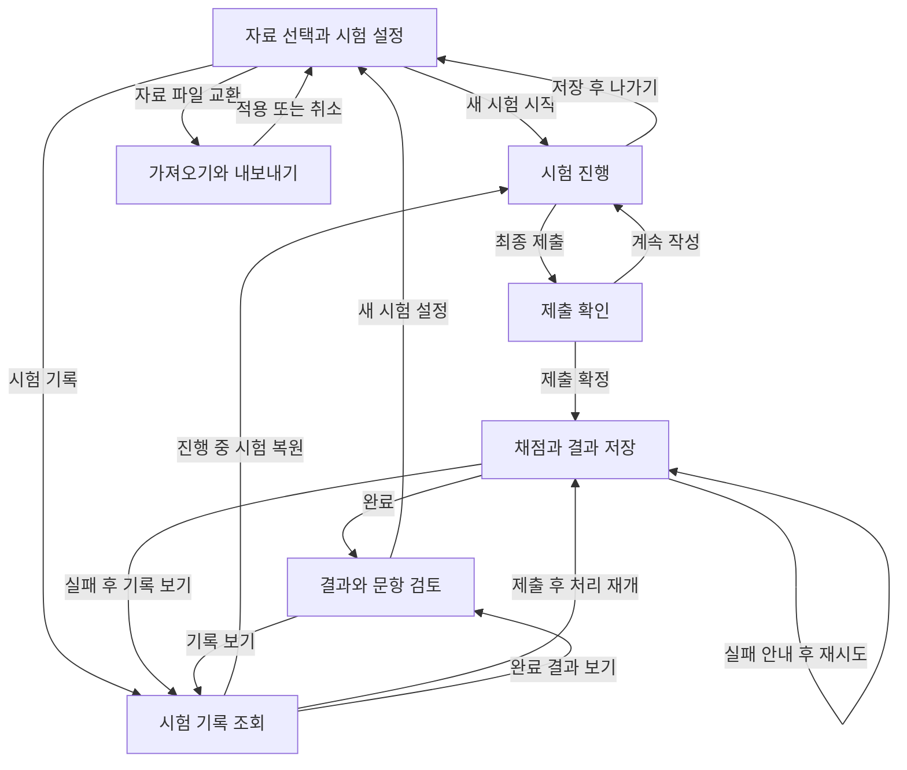

# 학습 앱 화면 연결

상태: 초기 설계 기준. 사용자 요구와 이번 작업의 구현 기준을 함께 반영했다.

자료를 선택해 새 시험을 만들거나, 시험 기록에서 기존 시험을 이어 푼다. 정답과 판정 결과는 최종 제출 후 채점과 저장이 완료되면 공개한다.

## 공통 전환 기준

- 시험 생성과 초기 저장이 성공한 뒤 시험 진행 화면으로 이동한다.
- 최종 제출 전에는 정답과 허용 표기 및 해설과 정답·오답 판정을 표시하지 않는다.
- 제출 확정 후에는 답변을 잠그고 처리 상태를 표시한다. 실패 시 같은 시험으로 재시도한다.
- 진행 중 시험에서 나갈 때는 최신 답변을 저장한다. 저장 실패 시 재시도하거나 현재 화면에 남을 수 있게 한다.
- 조회하는 과거 시험의 판정과 현재 학습 상태는 구분해 표시한다.

화면별 동작과 예외는 [화면 문서 목차](README.md), 시험 처리 상태는 [시험 기록 데이터](<../../공통 개발 문서/상세설계/데이터/02_1_시험기록.md>)를 따른다.
